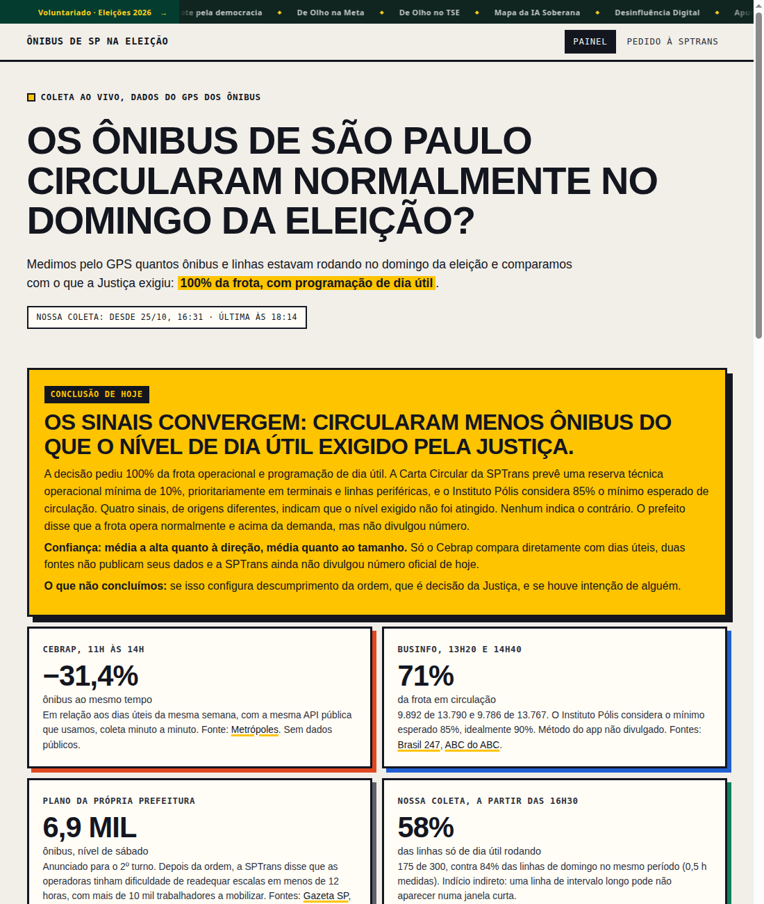
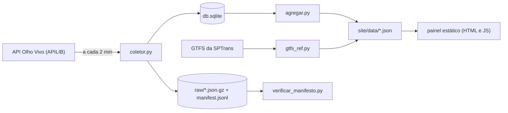

# Análise dos ônibus de São Paulo na eleição

**Auditoria independente da circulação dos ônibus municipais de São Paulo, com dados de GPS da SPTrans (API Olho Vivo) e o GTFS oficial.** Coleta a posição dos ônibus a cada 2 minutos, guarda cada resposta com hash encadeado (para provar que não foi alterada), e compara o dia da eleição com dias úteis e domingos normais. Só Python (biblioteca padrão), SQLite e JavaScript puro.

[](https://github.com/travahacker/analise-onibus/actions/workflows/testes.yml)
Licença MIT · Python 3.9+ · sem dependências externas · painel ao vivo: **<https://travahacker.com.br/analise-onibus/>**



*Captura do painel em 25/10/2026. O painel publicado continua sendo atualizado.*

Palavras-chave: SPTrans, Olho Vivo, ônibus, São Paulo, GPS, GTFS, transparência, dados abertos, eleições 2026, auditoria cidadã, civic tech, LAI.

## Por que este projeto existe

No segundo turno de 2026 (25/10), a Justiça Eleitoral mandou a Prefeitura de São Paulo operar 100% da frota de ônibus, com programação de dia útil. Houve denúncias de que isso não aconteceu, e **não existia série pública de posições de GPS para conferir**: a API do Olho Vivo só informa a posição atual. Este projeto é o que coletamos, medimos e publicamos, com o código aberto para que qualquer pessoa possa conferir o método ou repetir a coleta em outro dia.

## O que ele mede

- **Ônibus operando:** ligados a uma linha, com GPS atualizado nos últimos 3 minutos, vistos ao mesmo tempo. É uma foto simultânea. Inclui os parados em ponto final e exclui garagem e ônibus sem GPS.
- **Ônibus em movimento:** operando e deslocados ao menos 50 m desde a coleta anterior.
- **Linhas ativas:** letreiros de linha com ao menos um ônibus em movimento em 10 minutos, cruzados com as linhas que o GTFS programa para o tipo do dia.

## O que foi encontrado em 25/10/2026

Resumo do painel, atualizado em 29/10/2026, com as fontes. O painel publicado é a versão que vale.

- **Esta coleta**, de 16h30 à meia-noite de 25/10, comparada janela por janela aos dias úteis 26, 27 e 28/10 pelo mesmo método: em média **6,1 mil ônibus operando contra 9,4 mil** (64% do nível de dia útil, e em todas as horas entre 63% e 70%). Ônibus em movimento: 54% do nível de dia útil. Linhas com ônibus em movimento por janela: 95% (1.006 contra 1.055). A rede quase toda rodou, com menos ônibus por linha.
- **Cebrap** (mesma API pública, outras horas): entre 11h e 14h circularam em média 31,4% menos ônibus ao mesmo tempo que nos dias úteis da mesma semana ([Metrópoles](https://www.metropoles.com/sao-paulo/periferias-onde-lula-venceu-sao-as-mais-afetadas-por-falta-de-onibus-em-sp)). Sem dados públicos.
- **BusInfo** (método não divulgado): cerca de 71% da frota em circulação às 13h20 (71,7%, [Diário Carioca](https://www.diariocarioca.com/2026/10/25/politica/eleicoes/boulos-pedira-prisao-de-ricardo-nunes-por-frota-reduzida-em-sp/)) e às 14h40 (71%, [Brasil 247](https://www.brasil247.com/sudeste/sao-paulo-tem-apenas-71-dos-onibus-em-circulacao-diz-levantamento/)). O Instituto Pólis considera o mínimo esperado 85%.
- **Plano da própria Prefeitura:** cerca de 6,9 mil ônibus, nível de sábado ([Gazeta SP](https://www.gazetasp.com.br/cotidiano/sao-paulo-aumenta-frota-de-onibus-em-40-para-o-segundo-turno-das-eleicoes-e-tera-69-mil-veiculos-com-passagem-gratuita/)).

Conclusão do painel: no período medido circularam cerca de 36% menos ônibus do que num dia útil, com confiança alta para essa faixa horária (mesmo método nos dois lados) e média para o restante do dia, que depende de medições de terceiros. **O projeto não conclui** se houve descumprimento da ordem (decisão da Justiça) nem a intenção de ninguém. A coleta só começou às 16h30 de 25/10, então a manhã não foi medida por nós.

> Uma primeira versão do painel (25/10) usava um indicador de linhas que comparava conjuntos diferentes (linhas só de dia útil contra linhas de domingo) e foi descartado quando houve dias úteis medidos para calibrá-lo. A comparação atual usa o mesmo método e a mesma faixa horária nos dois lados.

## Começar em 2 minutos, sem credenciais

```bash
git clone https://github.com/travahacker/analise-onibus.git
cd analise-onibus
python3 -m unittest discover -s tests -v   # testes
./demo.sh                                  # abre o painel em http://127.0.0.1:8000/
```

O `demo.sh` sobe uma API simulada (`servidor/api_simulada.py`, dados fictícios), faz 4 coletas, agrega, confere a cadeia de hashes e serve o painel. É a forma mais rápida de entender o fluxo inteiro. Em sistemas muito enxutos o módulo `zoneinfo` pode precisar do pacote `tzdata`.

## Usar com a API real

A API do Olho Vivo exige credencial. **O que funcionou para nós foi o gateway APILIB da Prefeitura de São Paulo** (WSO2), e não o endpoint antigo:

1. Crie uma conta em <https://apilib.prefeitura.sp.gov.br/store>.
2. Crie uma aplicação e **assine a API "OlhoVivo v2.1"** (sem a assinatura, toda chamada dá 403, código 900908).
3. Gere as chaves da aplicação: você recebe uma *consumer key* e um *consumer secret*.
4. Rode o coletor. Ele troca as chaves por um token Bearer (válido por cerca de 1 hora) e o renova sozinho:

```bash
export ONIBUS_DATA=/var/lib/analise-onibus       # dados brutos e SQLite
export ONIBUS_OUT=/var/www/analise-onibus/data   # JSON do painel
export ONIBUS_MODO=gateway
export SPTRANS_CONSUMER_KEY=...
export SPTRANS_CONSUMER_SECRET=...
python3 servidor/coletor.py     # uma coleta
python3 servidor/agregar.py     # regenera os JSON do painel
python3 servidor/verificar_manifesto.py "$ONIBUS_DATA"
```

Agende com cron (exemplo em `servidor/analise-onibus.cron`):

```cron
*/2 * * * * set -a; . /etc/analise-onibus.env; set +a; python3 /opt/analise-onibus/coletor.py >> /var/log/analise-onibus.log 2>&1
*/5 * * * * python3 /opt/analise-onibus/agregar.py >> /var/log/analise-onibus.log 2>&1
```

| Variável | Para que serve |
|---|---|
| `ONIBUS_MODO` | `gateway` (APILIB, recomendado) ou `legado` (`api.olhovivo.sptrans.com.br`, padrão por compatibilidade) |
| `SPTRANS_CONSUMER_KEY`, `SPTRANS_CONSUMER_SECRET` | Credenciais do gateway, com renovação automática do token |
| `SPTRANS_ACCESS_TOKEN` | Token Bearer fixo, no lugar das chaves (expira em cerca de 1 hora) |
| `SPTRANS_TOKEN` | Token do modo legado |
| `ONIBUS_DATA` | Pasta de dados brutos e SQLite (padrão `/var/lib/analise-onibus`) |
| `ONIBUS_OUT` | Pasta dos JSON do painel |
| `OLHOVIVO_BASE` | Sobrescreve a URL base da API (usado nos testes e no `demo.sh`) |
| `ONIBUS_EVENTO` | Data (AAAA-MM-DD) do dia a comparar com os dias úteis em `comparacao.json` (padrão 2026-10-25) |

Espaço em disco: cada coleta comprimida pesa cerca de 0,9 MB, ou perto de 650 MB por dia. O coletor para sozinho se restarem menos de 5 GB livres.

## Como funciona



Cada resposta bruta fica guardada sem alteração, e o `manifest.jsonl` encadeia os hashes: `encadeado = sha256(encadeado anterior + sha256 da resposta)`. Alterar uma coleta antiga quebra a cadeia dali em diante, e o `verificar_manifesto.py` mostra onde. Os formatos estão em [`docs/DADOS.md`](docs/DADOS.md).

## Armadilhas conhecidas

Coisas que custaram horas e que quem for repetir a coleta deve saber:

- **O endpoint antigo recusou todas as chaves do portal DevPlace** (`POST /Login/Autenticar` devolvia `false`), mesmo com o aplicativo "homologado". Não sabemos se é atraso de sincronização ou migração. O gateway APILIB funcionou.
- **Cloudflare:** o endpoint antigo respondia 403 ao User-Agent padrão do Python. O coletor se identifica com um User-Agent de navegador.
- **O gateway devolve 500 de forma intermitente.** O coletor tenta de novo até 3 vezes.
- **No gateway, só `/Posicao` foi testado com sucesso** com a nossa assinatura. `/Linha/Buscar` deu 403 e não investigamos o motivo.
- **`/Posicao` lista só veículos ligados a uma linha, com GPS ativo.** Inclui ônibus parados em ponto final (cerca de 35% ficam parados entre duas coletas) e exclui os que estão na garagem. É uma foto simultânea, nunca o total que rodou no dia.
- **`c` e `cl` não são a mesma coisa.** `c` é o letreiro (igual ao `route_id` do GTFS) e `cl` é o código por sentido. Compare com o GTFS pelo `c`.
- **O GTFS não serve para estimar frota por hora.** Mais de três quartos das viagens têm serviço válido para todos os dias, e `frequencies.txt` não distingue o dia, então sábado e domingo saem iguais ao dia útil. Use o GTFS só para saber **quais linhas** deveriam operar.
- **A documentação anuncia HTTPS obrigatório desde 02/01/2024.** O endpoint antigo ainda respondeu por HTTP nos nossos testes, e o gateway redireciona (301) para HTTPS. Use HTTPS.

## Adaptar a outro dia, evento ou cidade

- **Outro dia ou evento:** edite `EVENTOS` e `J` (janela de votação) no início de `site/app.js`, e os textos do `site/index.html`.
- **Outra região:** o ponto de referência das zonas (`SE`) e os raios estão em `servidor/coletor.py`; a URL do GTFS está em `servidor/atualizar_gtfs.sh`.
- **Outra cidade com API parecida:** troque a URL base e confira o formato de `/Posicao`. Os outros arquivos só dependem dos campos `c`, `cl`, `vs[].p`, `ta`, `py` e `px`.
- O painel mostra cada dia coletado como uma linha no gráfico, então comparar mais dias não exige mudar código.

## Estrutura do repositório

```
servidor/     coletor, agregação, GTFS, verificador e API simulada
site/         painel estático (HTML, CSS e JS puros) e modelo de pedido à SPTrans
tests/        testes (unittest, só biblioteca padrão)
docs/         formato dos dados e captura de tela
exemplos/     amostra fictícia da resposta de /Posicao
demo.sh       demonstração local sem credenciais
deploy.sh     publicação em um servidor via ssh (adapte ao seu ambiente)
```

## Limites e ética

- Um painel como este só **mede e compara**. Menos ônibus ou linhas não prova intenção de ninguém nem, sozinho, descumprimento de decisão judicial.
- Os números de fontes diferentes (Cebrap, BusInfo, esta coleta) medem coisas diferentes e não são somados nem misturados.
- Os dados usados são de veículos (prefixo, linha e posição), sem informação pessoal.
- Quem for repetir a coleta deve respeitar os termos de uso da API da SPTrans e da APILIB. Este projeto é independente e não tem ligação com a SPTrans nem com a Prefeitura.
- Nada aqui é aconselhamento jurídico.
- O modelo de pedido de acesso à informação em `site/pedido-sptrans.txt` precisa de revisão antes de ser enviado.

## Contribuir

Veja [`CONTRIBUTING.md`](CONTRIBUTING.md). Ideias úteis: mediana e percentil 90 dos intervalos entre ônibus, importar históricos obtidos por LAI, exportar agregados em CSV, testes para o JavaScript, adaptação a outras cidades e revisão de metodologia.

## English summary

An independent audit of São Paulo's municipal bus circulation on election day (2026-10-25), built on the SPTrans Olho Vivo real-time GPS API and the official GTFS feed. A stdlib-only Python collector polls vehicle positions every 2 minutes, stores each raw response with a SHA-256 hash chain for tamper evidence, and a static dashboard compares the election day with weekdays and regular Sundays. Run `./demo.sh` for a full local demo against a simulated API, no credentials needed. Notes for anyone using the real API: the legacy endpoint rejected portal keys for us, the APILIB gateway (WSO2, client-credentials Bearer token) worked, and `/Posicao` shows only vehicles linked to a line with an active GPS, including those parked at terminals. The dashboard text is in Brazilian Portuguese. MIT licensed.

## Licença e créditos

MIT, veja [`LICENSE`](LICENSE). Dados de posição e GTFS: SPTrans / Prefeitura de São Paulo. Medições de terceiros citadas: Cebrap, BusInfo e Instituto Pólis, conforme a imprensa. Projeto da Travahacker.
